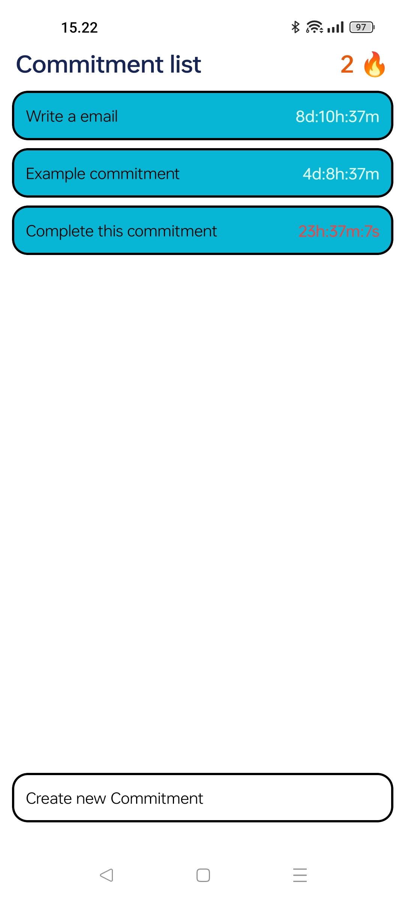
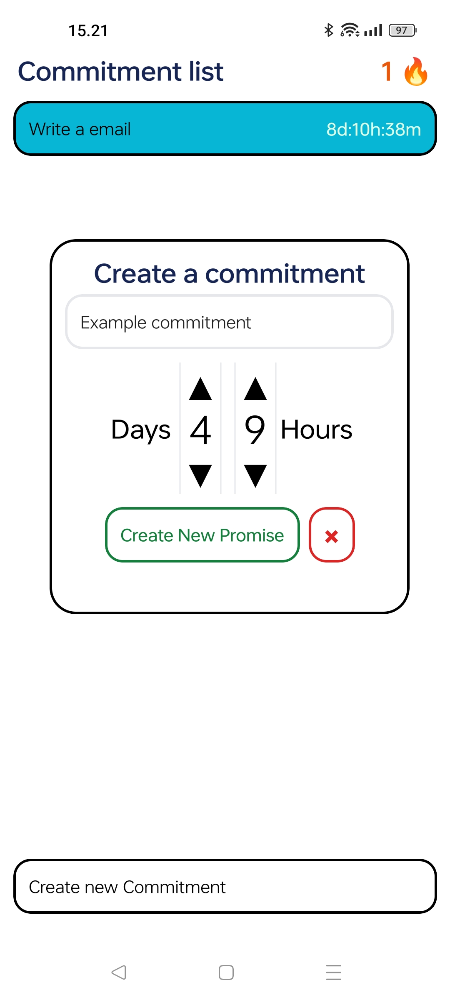
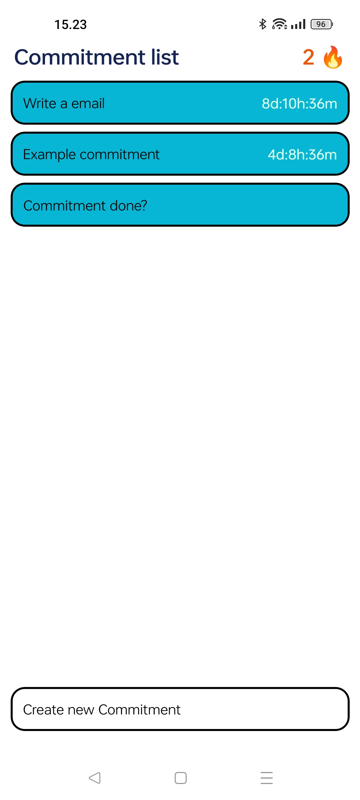

# Commitment-list

### About
Commitment-list is my side project that i created to help me fix my biggest weakness procrastination.
Applications concept is simple a list with a timer if you don't complete commitment in time your streak ends and when commitment are completed in time it adds to your streak.

Commitment and streak is stored in device using React-native-AsyncStorage.
Styling is done by using tailwind/nativewind.

### Problems in project
- No checks that Commitment is complete, Fix: Back-end where each completion is send with image and description of what image contains and AI
  (small qwen model with image support) to confirm before sending completion back to user and increasing Streak.
- Timer continues to roll down after it hits zero

### Features list
#### Existing features
- Adding new commitment.
- Completion of commitment after long press on active commitment.
- Streak increasing on completion.
- Streak resetting on launch if expired/time ended on commitment.

#### Features to do
- Adding back-end support for completion checks.
- Removing old commitments that were not done on time (Completing expired commitment dose not increase streak).
- If timer hits zero it will stop counting and shows expired text.

#### Development screenshosts
<table align="center">
  <tr>
    <td align="center">Default View</td>
    <td align="center">New Commitment</td>
    <td align="center">Commitment completion</td>
  </tr>
  <tr>
    <td></td>
    <td> </td>
    <td></td>
  </tr>
</table>
